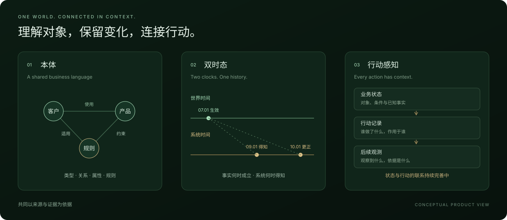

  

  <strong>面向企业与 Agent 的双时态、行动感知世界模型</strong> 
  以本体连接知识，以时间保留变化，让行动拥有上下文。

  <a href="#理念">理念</a> ·
  <a href="#三个核心">三个核心</a> ·
  <a href="#使用场景">使用场景</a> ·
  <a href="#开始使用">开始使用</a> ·
  <a href="#接下来的方向">路线图</a>

  
  

**让企业与 Agent，理解同一个业务世界。**

OntoWeave 是一个开源世界模型项目。我们围绕本体、双时态与行动感知，将分散的资料组织为有来源、有关系、有时间的业务知识，为企业和 Agent 提供能够持续更新的共同上下文。

## 理念

企业的世界一直在变化。产品更新，规则调整，职责交接，新的信息也会改变我们对过去的理解。

我们希望保留这段变化的过程：一件事是什么，它与什么有关，何时成立，我们何时得知；进一步理解谁采取了行动，之后观察到了什么。

**把事实织成世界，把变化留在时间里。**

## 三个核心

**本体 · 让知识拥有共同语言**

围绕对象、类型、关系、属性与规则组织业务知识。让不同资料里的产品、客户、人员与事件逐步连接起来，形成企业与 Agent 都能使用的语义骨架。

**双时态 · 同时保留事实与认识的历史**

区分事实在现实中何时成立，以及系统何时记录这项认识。一项规则 7 月生效，9 月才被录入：回看 8 月的业务状态与当时已知的信息，需要两条时间线。现实变化与认识更正，都应留下历史。

**行动感知 · 为变化补上行为上下文**

谁在什么条件下，对哪个对象做了什么，随后观察到什么？我们正在将行动与反馈纳入同一份业务表达，为复盘、经验积累和后续决策建立基础。

  
  产品概念图 · 行动与反馈闭环持续建设中

## 使用场景

从业务中的具体问题出发，理解 OntoWeave 希望支撑的工作。

| 面向谁 | 关心的问题 | 带来的价值 |
|---|---|---|
| **企业业务团队** | “这项规则在当时适用于谁？我们什么时候得知变更？” | 连接业务对象、规则与证据，按两种时间回看事实。 |
| **研究与运营团队** | “当时依据什么作出判断？后来哪些事实改变了？” | 保留来源和认识更正，为复盘提供可回查的上下文。 |
| **持续工作的 Agent** | “当前该参考什么？先前做过什么，结果如何？” | 以时态知识为基础，逐步扩展行动记忆与反馈；外部接入仍在建设。 |

## 当前可以体验什么

| 能力 | 体验 |
|---|---|
| **从资料建立知识** | 上传资料，发现知识需求，组织对象、关系与属性。 |
| **探索图谱与本体** | 查看知识之间的联系，并回查对应资料。 |
| **带依据的对话** | 流式回答、Markdown、句内引用与原文预览。 |
| **保留变化的历史** | 事实版本、现实变化、认识更正与双时间读取基础。 |

底层采用原生 Codex Agent 与 Skill，结合 Rust 时态内核和本机存储。

> **当前版本：v0.1.0-alpha.1。** 面向 macOS 本机单用户验证；抽取与实体归一质量仍在迭代。行动反馈闭环、外部 Agent MCP 接入及预测尚未完成交付。详见[版本说明](docs/RELEASE_NOTES.md)。

## 开始使用

1. 按[安装与启动指南](docs/GETTING_STARTED.md)准备本机环境并启动 OntoWeave。
2. 在设置中配置生成与 Embedding 服务，创建工作空间并上传资料。
3. 探索图谱、提出问题，从引用回到原文。

## 接下来的方向

- **行动与反馈**：连接业务状态、行动记录和观测结果。
- **Agent 共享记忆**：通过 MCP 向外部 Agent 提供知识读写能力。
- **基于反馈的学习与预测**：在可追溯记录上逐步验证行动效果与预测能力。

欢迎通过 [Issues](https://github.com/xufanghanjoker-ux/OntoWeave/issues) 分享场景、问题与建议，或参与[贡献](CONTRIBUTING.md)。

---

  <strong>Understand the world. Preserve its history. Give actions context.</strong> 
  <a href="LICENSE">Apache-2.0</a> · <a href="SECURITY.md">安全说明</a> · <a href="THIRD_PARTY_NOTICES.md">第三方许可</a> 
  感谢 Utopia、Graphiti 与 LightRAG 带来的启发。

