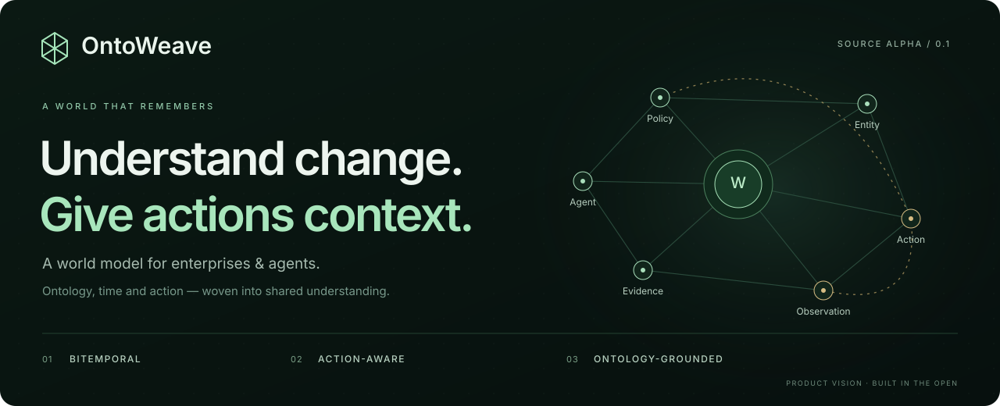
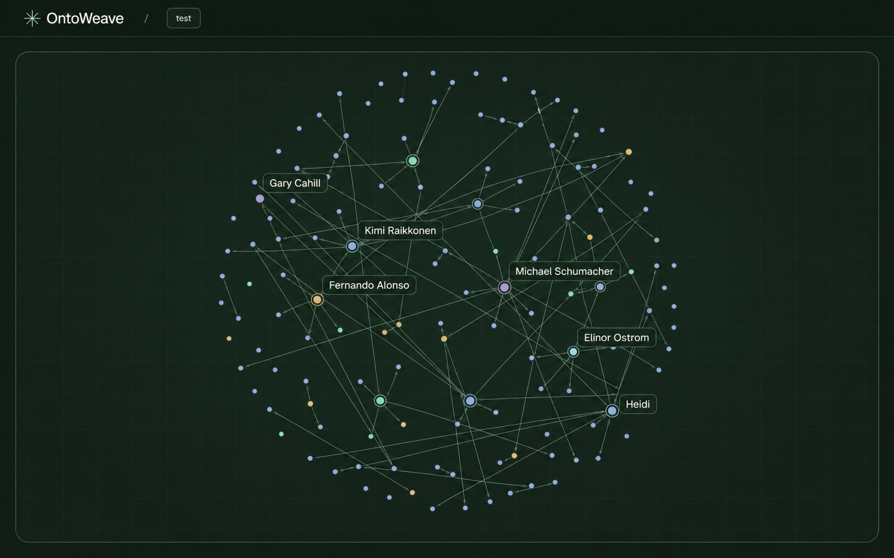

  

  <strong>面向企业与 Agent 的双时态、行动感知世界模型</strong> 
  从业务资料建立可追溯的知识图谱，回看事实何时成立、系统何时记录。

  <a href="#本体时间与行动">本体、时间与行动</a> ·
  <a href="#新版工作台">新版工作台</a> ·
  <a href="#开始使用">开始使用</a> ·
  <a href="https://github.com/xufanghanjoker-ux/OntoWeave/releases/tag/v0.2.0-alpha.2">下载 v0.2.0-alpha.2</a>

  

手册或业务规则更新后，旧版本还可能是复盘的依据。OntoWeave 将资料中的对象、关系、属性和规则组织成知识图谱，并为修订保留来源和历史版本。

> **v0.2.0-alpha.2** 是 macOS 本机单用户预览版。新版工作台、图谱与本体、历史回看和引用问答已开放体验。 [版本说明](docs/RELEASE_NOTES.md)

## 本体、时间与行动

**本体描述业务怎么关联。** 例如「产品适用售后规则」是一种关系。本体图展示资料中观察到的类型关系，实例图则显示哪款产品适用哪条规则。可以从定义跳到相关实例，也能从实例回看对应定义。

**双时态保留事实和认识各自的时间。** 假设一项售后规则在 7 月 1 日生效，团队到 9 月 3 日才录入。回看 8 月时，可以分别查「按现在掌握的信息，当时哪条规则有效」和「截至 8 月底，系统当时记录的是哪条规则」。在「回看历史」中，可以选择事实日期，也可以按当时掌握的信息回放。

**行动感知是接下来的方向。** 将行动涉及的对象、行动前的业务状态和事后的观察关联起来，供人和 Agent 复盘。 [产品概念图](docs/assets/world-model.svg)

## 新版工作台

| 你可以做什么 | 工作台如何呈现 |
| --- | --- |
| **导入资料并查看图谱** | 上传 PDF、Word 或 Markdown。发布后自动进入实例图，工作空间支持追加和替换资料。 |
| **浏览本体、实例和原文** | 从本体定义定位相关对象，在资料页按文件名或正文搜索，打开保留的原文。 |
| **处理有疑问的知识** | 对照双方描述和来源，预览处理影响。处理结果发布后，可以定位图中发生变化的对象或关系。 |
| **提问并核对依据** | 查看流式回答，点引用先预览引句，再打开同版本原文。已保存的会话与引用可在重启后继续查看和使用。 |

  
   OntoWeave 图谱展示 · 基于 test 工作空间截图的视觉示意

## 开始使用

1. 下载[预发布源码包](https://github.com/xufanghanjoker-ux/OntoWeave/releases/tag/v0.2.0-alpha.2)，按[安装与启动指南](docs/GETTING_STARTED.md)配置 PostgreSQL 和 pgvector。
2. 启动工作台，在设置中配置模型服务，创建工作空间并上传资料。
3. 等待发布后查看图谱，提出一个资料能够回答的问题，点击引用核对原文。

OntoWeave 使用原生 Codex Agent 与 Skill 完成知识构建和检索问答。Rust 负责时态规则与检索内核，PostgreSQL 保存知识版本、索引和会话。

## 路线图

- **外部 Agent 接入** · 通过 MCP 将可追溯的知识读写接入 Agent 的工作流。
- **时序分析与预测** · 基于历史状态、行动和反馈，验证变化分析与预测能力。

欢迎通过 [Issues](https://github.com/xufanghanjoker-ux/OntoWeave/issues) 分享实际使用场景，或参与[贡献](CONTRIBUTING.md)。

[Apache-2.0 许可证](LICENSE) · [安全说明](SECURITY.md) · [第三方许可](THIRD_PARTY_NOTICES.md)

感谢 Utopia、Graphiti 与 LightRAG 带来的启发。
